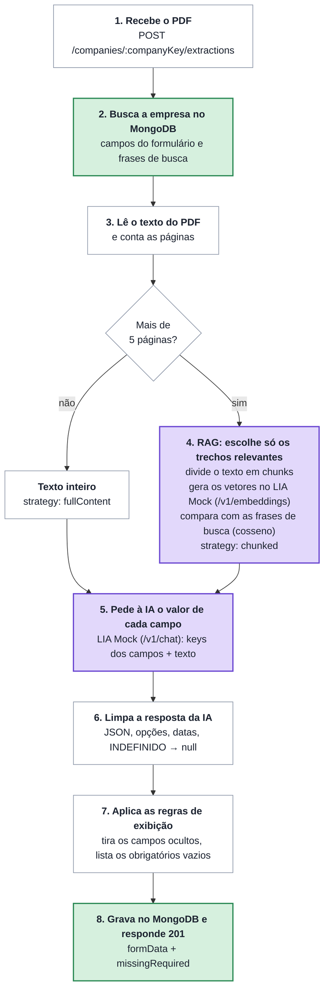

# Teste técnico — Mini-LIA

Desenvolvedor(a) Fullstack, foco em backend

## Contexto

Em nosso produto, integramos IA a fluxos jurídicos para agilizar processos operacionais das empresas clientes. Um desses fluxos é o cadastro: a partir de um documento, a IA preenche um formulário. Cada empresa cliente tem o **seu** formulário: campos diferentes, opções diferentes e regras que mostram ou escondem campos conforme o que já foi preenchido.

Neste teste você vai construir uma versão pequena desse fluxo: uma API que recebe um PDF, pede à IA os campos daquela empresa, limpa a resposta e devolve o formulário pronto.

Você **não** precisa de chave de nenhuma IA paga. O repositório traz o **LIA Mock**, um serviço que roda na sua máquina (com ou sem Docker) e imita uma API de IA: um endpoint de chat e um de embeddings. Você o chama por HTTP como chamaria a OpenAI, mas sem custo e sem internet. Ele responde de forma previsível, e é por isso que dá para corrigir o teste automaticamente.

<div style="page-break-before: always;"></div>

## Como as peças se conectam

O fluxo do `POST /companies/:companyKey/extractions`, do PDF recebido à resposta:



Em verde, as etapas que usam o MongoDB; em roxo, as que chamam o LIA Mock. Cada etapa está detalhada na seção [3. `POST /companies/:companyKey/extractions`](#3-post-companiescompanykeyextractions).

<div style="page-break-before: always;"></div>

## O que já vem pronto

```
data/
  companies.json      2 empresas
  fields.json         campos de cada empresa (tipos, opções, regras de exibição)
  queries.json        frases de busca por empresa, para o RAG
  documents/          processo-curto.pdf (3 páginas) e processo-longo.pdf (18 páginas)
lia-mock/             o mock da IA (não altere)
postman/              coleção com exemplos de chamada ao mock
docker-compose.yml    mongo + lia-mock; você adiciona a sua API
```

A coleção `postman/lia-mock.postman_collection.json` tem exemplos prontos de chamada ao mock: extração de campos (com o modo de depuração), um prompt grande demais (413) e embeddings, com o cálculo de similaridade de cosseno no script de teste da requisição.

## Rodando o ambiente: com ou sem Docker

Sua API depende de duas coisas: um **MongoDB** e o **LIA Mock**. Para desenvolver, você pode subir os dois com Docker, sem Docker, ou misturar. A API só precisa ler dois endereços de variáveis de ambiente (veja o `.env.example`):

| Variável | O que é |
|---|---|
| `MONGO_URI` | conexão com o MongoDB |
| `LIA_BASE_URL` | endereço do LIA Mock |

### Com Docker

```bash
docker compose up -d mongo lia-mock
```

Sobe um MongoDB 7 em `localhost:27017` e o mock em `localhost:4010`. Com a sua API rodando fora do Docker (`npm start`, por exemplo):

```bash
MONGO_URI=mongodb://localhost:27017/mini-lia
LIA_BASE_URL=http://localhost:4010
```

### Sem Docker

**LIA Mock:** é Node puro, sem dependências. Não precisa de `npm install` (Node 20 ou superior):

```bash
cd lia-mock
node src/server.js        # sobe em http://localhost:4010
```

Para ligar o modo de depuração: `MOCK_DEBUG=1 node src/server.js`.

**MongoDB**, escolha uma opção:

| Opção | `MONGO_URI` | Observação |
|---|---|---|
| MongoDB instalado na sua máquina | `mongodb://localhost:27017/mini-lia` | MongoDB Community, versão 6 ou superior |
| MongoDB Atlas (plano gratuito) | `mongodb+srv://<usuário>:<senha>@<cluster>/mini-lia` | na nuvem, não instala nada; precisa de internet |
| [`mongodb-memory-server`](https://github.com/typegoose/mongodb-memory-server) | gerado na hora, pelo próprio pacote | sobe um Mongo temporário dentro do processo Node; baixa o binário na primeira execução e os dados somem quando o processo para. Só para a sua máquina: não funciona na imagem `node:alpine` |

### Misturando os dois

De dentro de um container, `localhost` é o próprio container. Então:

| Sua API roda… | Mongo e mock rodam… | Endereços |
|---|---|---|
| fora do Docker | no Docker ou fora | `localhost:27017` e `localhost:4010` |
| no compose | no compose | `mongodb://mongo:27017/mini-lia` e `http://lia-mock:4010` (nomes dos serviços) |
| num container | fora do Docker | `host.docker.internal:27017` e `host.docker.internal:4010` |

### E na entrega?

Desenvolva como preferir. Na entrega, o ideal é que tudo suba com **`docker compose up`**: Mongo, mock e a sua API, juntos. É assim que rodamos a correção. Se não for possível, documente no seu README como rodar sem Docker; aceitamos, mas a entrega com Docker conta a favor (veja [Entrega](#entrega)).

## O que construir

Uma API em **Node.js** com **MongoDB**. Framework e bibliotecas ficam à sua escolha.

### 1. Seed

A API lê do banco as empresas, os campos de cada formulário e as frases de busca. Para não ter que cadastrar tudo isso à mão, empresa por empresa e campo por campo, é comum ter um **script de seed**: um script que lê arquivos com os dados iniciais e popula o banco. Assim qualquer pessoa (inclusive a nossa correção) sobe o projeto já com os dados certos.

Crie esse script, rodando com **`npm run seed`**, que carrega no Mongo os arquivos da pasta `data/`:

| Arquivo | O que tem |
|---|---|
| `companies.json` | as 2 empresas (`key` e nome) |
| `fields.json` | os campos do formulário de cada empresa (13 da `acme-edu` e 12 da `rodovia-sul`), ligados à empresa por `companyKey` |
| `queries.json` | as frases de busca do RAG de cada empresa, agrupadas pela `key` da empresa |

Como guardar esses dados (quantas coleções, que formato) fica a seu critério.

**O seed precisa poder rodar mais de uma vez.** Rodar de novo não pode duplicar nada: depois de duas execuções, o banco continua com 2 empresas e 25 campos. E se um arquivo mudar (um `label` corrigido, uma opção nova), rodar o seed de novo atualiza o que já existe. Dica: cada registro tem uma chave natural (`key` da empresa; `companyKey` + `key` do campo) que serve para isso.

Na entrega, o seed deve rodar sozinho quando o projeto sobe com `docker compose up` (veja [Entrega](#entrega)).

### 2. `GET /companies/:companyKey/fields`

Devolve os campos da empresa ordenados por `order`, com o mesmo formato de `data/fields.json`. `404` se a empresa não existir.

### 3. `POST /companies/:companyKey/extractions`

Recebe um PDF em `multipart/form-data`, no campo `file`. Responde `201`:

```json
{
  "id": "6710f0c2a1b2c3d4e5f60718",
  "companyKey": "acme-edu",
  "strategy": "fullContent",
  "usedChunks": 0,
  "formData": { "NUMERO_PROCESSO": "1012345-67.2025.8.26.0114", "CPF_AUTOR": null, "...": "..." },
  "missingRequired": []
}
```

Erros: `400` sem arquivo ou com arquivo que não é PDF; `404` para empresa inexistente; `502` se a chamada à IA falhar.

O que acontece dentro do endpoint:

**a) Estratégia.** Leia o texto do PDF (ex.: `pdf-parse`).
- **Até 5 páginas** (`strategy: "fullContent"`): o texto vai inteiro para a IA.
- **Mais de 5 páginas** (`strategy: "chunked"`): o texto não cabe no prompt. Faça RAG: divida o texto em trechos (chunks), gere os embeddings dos trechos e das frases de `queries.json` daquela empresa com o `/v1/embeddings` do mock, ordene os trechos por **similaridade de cosseno** e mande para a IA só os mais relevantes. Use os `topK` de cada frase, sem repetir trecho. `usedChunks` é quantos trechos foram no prompt.

**b) Prompt.** Peça para a IA retornar o valor de cada campo da empresa, a partir do texto selecionado no passo anterior. Identifique cada campo pela `key` exata (ex.: `NUMERO_PROCESSO`): é por ela que a IA devolve os valores.

**c) Pós-processamento.** A resposta da IA não é confiável. Transforme-a em valores:
- extraia o JSON da resposta (ele pode vir no meio de texto e dentro de ```json);
- descarte chaves que não são campos da empresa;
- `"INDEFINIDO"`, `"NÃO SE APLICA"`, `"N/A"` e vazio viram `null`;
- **text**: o texto sem espaços nas pontas;
- **date**: a IA pode responder `DD/MM/AAAA` ou `AAAA-MM-DD`; grave `AAAA-MM-DD`, ou `null` se não for uma data válida;
- **select**: grave o `value` da opção. A IA pode responder o `label` ou o `value`, em qualquer caixa e com ou sem acento (`"NÃO"`, `"nao"` e `"N"` são a opção `{ value: "N", label: "Não" }`). Se não casar com nenhuma opção, `null`. Não chute por semelhança.

**d) Regras de exibição (`attached`).**
- Campo sem `attached`: sempre visível.
- Campo com `attached`: visível quando **todas** as condições valem. A condição `{ "key": "X", "values": ["A", "B"] }` vale quando o valor de X é `"A"` ou `"B"`.

**e) Resposta.** O `formData` tem **todos os campos visíveis** (com `null` quando não houver valor) e **nenhum campo oculto**. `missingRequired` lista os campos `required` que estão visíveis e vazios. Campo oculto nunca é obrigatório.

**f) Persistência.** Grave a extração no Mongo.

#### Respostas esperadas para os PDFs fornecidos

Use para conferir a sua implementação. `id` e `createdAt` mudam a cada chamada, `usedChunks` depende do seu RAG, e campos a mais na resposta não atrapalham.

`POST /companies/acme-edu/extractions` com `data/documents/processo-curto.pdf`:

```json
{
  "id": "6ad0d9d9bef8409cec867662",
  "companyKey": "acme-edu",
  "strategy": "fullContent",
  "usedChunks": 0,
  "formData": {
    "NUMERO_PROCESSO": "1012345-67.2025.8.26.0114",
    "DATA_DISTRIBUICAO": "2025-03-12",
    "NOME_AUTOR": "Mariana Costa Ribeiro",
    "CPF_AUTOR": "123.456.789-09",
    "TIPO_ACAO": "DANOS_MORAIS",
    "NEGATIVACAO": "S",
    "ORGAO_NEGATIVACAO": "SERASA",
    "PEDIDO_LIMINAR": "S",
    "DESCRICAO_LIMINAR": "Exclusão imediata do nome da autora dos cadastros de inadimplentes",
    "VALOR_DANO_MORAL": "R$ 15.000,00",
    "VALOR_CAUSA": "R$ 19.870,00"
  },
  "missingRequired": []
}
```

`NOME_CURSO` e `NUMERO_MATRICULA` não aparecem: a IA devolve os dois, mas eles só são visíveis quando `TIPO_ACAO` é `COBRANCA_INDEVIDA` ou `DIPLOMA`.

`POST /companies/rodovia-sul/extractions` com `data/documents/processo-longo.pdf`:

```json
{
  "id": "6ad0dbb128fdd31dc862720a",
  "companyKey": "rodovia-sul",
  "strategy": "chunked",
  "usedChunks": 11,
  "formData": {
    "NUMERO_PROCESSO": "5004321-10.2025.8.21.0001",
    "NOME_AUTOR": "Carlos Eduardo Nunes",
    "TIPO_OCORRENCIA": "ACIDENTE",
    "DATA_FATO": "2025-01-22",
    "NOME_RODOVIA": "BR-116",
    "KM_RODOVIA": "km 245",
    "PLACA_VEICULO": "ABC1D23",
    "HOUVE_VITIMA": "S",
    "TIPO_LESAO": "GRAVE",
    "NUMERO_BO": "2025/000987",
    "DATA_BO": "2025-01-23",
    "VALOR_CAUSA": "R$ 250.000,00"
  },
  "missingRequired": []
}
```

Se algum campo vier `null` aqui, o trecho do PDF que comprova o valor não chegou no prompt: reveja o RAG (use o modo de depuração do mock, abaixo).

### 4. `GET /extractions/:id`

Devolve a extração gravada, no mesmo formato. `404` se não existir.

### 5. README

Como rodar o projeto e as decisões que você tomou.

## O LIA Mock

Base: `http://localhost:4010` (dentro do compose, `http://lia-mock:4010`).

### `POST /v1/chat`

```json
{
  "system": "opcional",
  "messages": [{ "role": "user", "content": "..." }]
}
```

Responde `{ "text": "...", "usage": { "inputTokens": 0, "outputTokens": 0 }, "model": "lia-mock-1" }`. O JSON com os campos vem dentro de `text`.

- **Limite de 16.000 caracteres** somando `system` e todas as `messages`. Acima disso: `413` com `code: "context_length_exceeded"`.
- O "modelo" só responde as keys que aparecem no prompt, e só acha um valor se o trecho do documento que o comprova estiver no prompt. Senão, responde `"INDEFINIDO"`. Ou seja: RAG ruim aparece como campo vazio.
- Ele se comporta como um LLM de verdade: às vezes responde chaves que ninguém pediu, labels no lugar de values, caixa e acento variados.

### `POST /v1/embeddings`

`{ "inputs": ["texto 1", "texto 2"] }` → `{ "vectors": [[...], [...]], "dimensions": 512 }`

Um vetor por texto, na mesma ordem. Textos parecidos geram vetores próximos; a comparação (similaridade de cosseno) e a escolha dos trechos ficam com você.

### Depuração

Com `MOCK_DEBUG=1` no serviço do mock (ou o header `x-mock-debug: 1` na requisição), a resposta do chat traz `debug.missingEvidence`: as keys pedidas cujo trecho não chegou no prompt. Útil para ajustar o RAG.

## Entrega

1. Um repositório no GitHub (público, ou privado com convite para quem enviou o teste).
2. `docker compose up` sobe **tudo**: mongo, lia-mock e a sua API na porta **3000**, com o seed rodando automaticamente.

O ideal é a entrega com Docker. Se não conseguir, documente como rodar sem ele (`MONGO_URI`, `LIA_BASE_URL` e os comandos; veja [Rodando o ambiente](#rodando-o-ambiente-com-ou-sem-docker)). Aceitamos, mas o Docker conta a favor.

> Na correção, rodamos a sua API contra documentos **além** dos dois fornecidos, das mesmas empresas. Implemente as regras, não as respostas.

## Como avaliamos

- Funciona: os endpoints respeitam o contrato e o formulário sai certo.
- Regras genéricas: nada de `if` por empresa ou por campo. Uma terceira empresa em `data/` deveria funcionar sem mudar código.
- Organização: rotas, regras de negócio e integrações (Mongo, IA) separadas.
- Tratamento de erros: status HTTP coerentes, inclusive quando a IA falha.
- README claro, com as suas decisões e o que faria com mais tempo.

## Bônus (opcional)

Uma tela React que renderiza o formulário de uma empresa aplicando as regras de exibição.

Se algo no enunciado estiver ambíguo, escolha um caminho, siga e registre no README.
